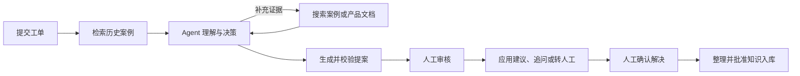
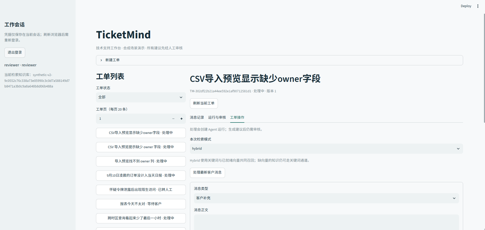
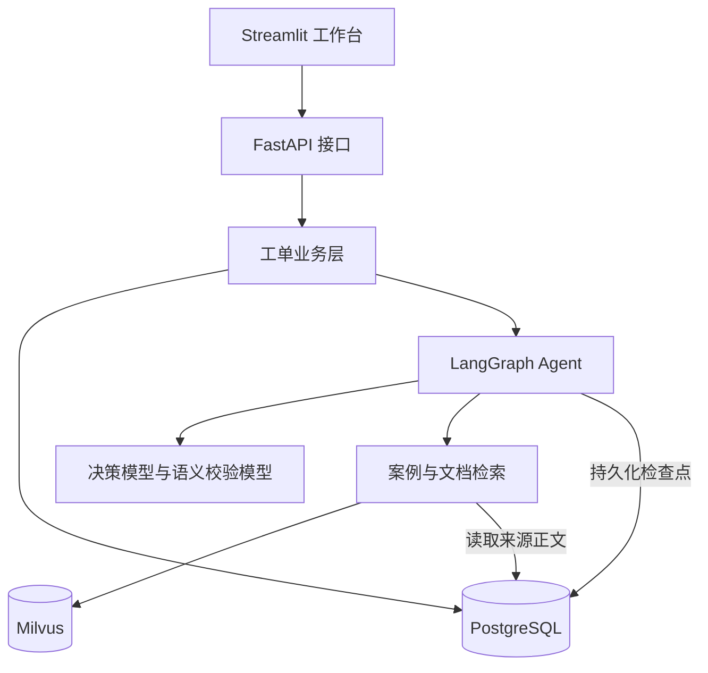

# TicketMind

带人工审核的 SaaS 客服工单 Agent。TicketMind 根据客户问题检索历史案例与产品文档，生成解决建议、追问或转人工提案，由审核人员确认后应用结果，并支持将已解决工单整理为知识文章。

项目采用单 Agent、模块化单体架构，提供 FastAPI 接口和 Streamlit 工作台，覆盖工单提交、证据检索、提案生成、人工审核、结果保存与知识入库的完整流程。

## 功能概览

| 功能 | 说明 |
| --- | --- |
| 工单管理 | 创建工单、补充客户消息、查看消息与运行历史，支持人工回复、接管和关闭 |
| Agent 处理 | 根据问题与检索证据生成提案，按需调用 `search_cases`、`search_docs` 两个只读工具 |
| 证据检索 | 历史案例支持 Dense、BM25 与 Hybrid 检索；产品文档使用独立 BM25 索引，保留来源与正文快照 |
| 提案校验 | 独立模型校验提案语义，校验失败最多进行一次修正；工具调用受次数与活跃时间预算约束 |
| 人工审核 | 支持批准、编辑与转人工；回复应用和工单关闭由人工确认 |
| 持久化与恢复 | 保存 Agent 检查点，由审核人员显式恢复符合条件的中断运行；拒绝不兼容或配置漂移的恢复 |
| 知识沉淀 | 人工整理已解决工单并批准入库，分别记录知识发布与索引就绪状态 |

## 工作流程



Agent 生成提案后进入待审核状态。审核通过会应用审核后的动作，但不会自动将工单标记为已解决；关闭工单是独立的人工操作。客户补充信息后，可基于最新消息启动新一轮处理。



## 架构与技术栈



| 层次 | 技术与职责 |
| --- | --- |
| 工作台 | Streamlit，通过 HTTP 操作工单与审核提案 |
| 接口与数据结构 | FastAPI、Pydantic，校验身份、请求参数与结构化输入输出 |
| 业务与持久化 | PostgreSQL、SQLAlchemy、Alembic，管理状态、版本、幂等、事务与迁移 |
| Agent 编排 | LangGraph，编排检索、决策、只读工具、语义校验与人工审核中断 |
| 检索 | Milvus，提供向量与 BM25 检索；Hybrid 使用 RRF 融合 |
| 开发与验证 | Python 3.12、uv、pytest；Docker Compose 提供本地数据库与检索服务 |

模型负责理解问题、选择受控工具和生成提案；代码负责权限、状态迁移和数据库写入。工单状态与 Agent 运行状态分别管理，模型调用在业务数据库事务外执行。详细设计与接口见 [架构文档](docs/architecture.md)。

## 安装与配置

以下命令在仓库根目录执行，适用于 Windows PowerShell。

可以选择两种运行方式：

| 模式 | 所需服务 | 用途 |
| --- | --- | --- |
| 演示模式 | PostgreSQL | 使用确定性模型与检索替身体验业务流程，无需模型凭据或 Milvus |
| 真实模式 | PostgreSQL、Milvus、模型服务；Hybrid 还需要 Embedding 配置与缓存 | 使用真实模型和检索处理工单，可能产生调用费用 |

### 1. 安装与环境变量

准备 Python 3.12、uv、Docker Desktop，以及 PostgreSQL（本机服务或下方容器）。

```powershell
uv sync --locked
if (-not (Test-Path .env)) { Copy-Item env.example .env }
```

编辑 `.env`：

| 配置 | 填写内容 |
| --- | --- |
| `TICKETMIND_DATABASE_URL` | `postgresql+psycopg://用户名:密码@主机:端口/数据库`；密码特殊字符需 URL 编码 |
| `DASHSCOPE_API_KEY` | 百炼 API Key |
| `DASHSCOPE_WORKSPACE_ID` | 与 Key 对应的北京地域业务空间 ID |
| `TICKETMIND_DECISION_MODEL` | 示例为 `qwen3.8-flash` |
| `TICKETMIND_JUDGE_MODEL` | 配置独立审核模型；示例为 `deepseek-v4.1-flash` |
| `TICKETMIND_MILVUS_URI` | 本地为 `http://127.0.0.1:19530` |
| `TICKETMIND_RETRIEVAL_MODE` | `hybrid`；Cases 使用 Dense + BM25，Top-K=5 |
| `TICKETMIND_RETRIEVAL_TOP_K` | `5`；candidate_k=20、RRF k=60 |
| `TICKETMIND_DOCS_DATASET` | `synthetic-phase7-docs-v1` |
| `TICKETMIND_DOCS_RETRIEVAL_MODE` | `bm25` |
| `TICKETMIND_AGENT_VERSION` | `ticketmind-tools-docs-v2` |

生成本地 operator / reviewer 登录令牌，不覆盖已有令牌：

```powershell
uv run --no-sync python scripts/configure_local_auth.py
```

`.env`、登录令牌和本地缓存不提交 Git。模型配置示例不代表调用授权；实际处理工单会调用模型并可能产生费用。

### 2. 启动 PostgreSQL 与 Milvus

已有 PostgreSQL 服务时，在 `.env` 填写其实际连接信息。使用仓库容器时执行：

```powershell
if (-not (Test-Path infra/postgres/.env)) { Copy-Item infra/postgres/env.example infra/postgres/.env }
# 编辑 infra/postgres/.env，设置 POSTGRES_PASSWORD
docker compose --project-directory infra/postgres up -d --wait
```

容器连接为 `localhost:5433`，用户 `ticketmind_app`，数据库 `ticketmind_dev`；根目录 `.env` 的密码须与 `POSTGRES_PASSWORD` 一致。

```powershell
docker compose --project-directory infra/milvus up -d --wait
uv run --no-sync alembic upgrade head
```

### 3. 初始化示例知识库

默认使用最后一次完整评测的 Phase 7 数据：120 条合成案例、8 篇产品文档。`.env` 中设置 `TICKETMIND_CORPUS_PATH=data/synthetic/phase7_v1/historical_cases.jsonl` 后执行以下命令，不调用模型或 Embedding：

```powershell
uv run --no-sync python scripts/knowledge.py seed
$dataset = 'synthetic-v2-9c0552c76c338a73e05990c3c0d7a588149d7b8471a3b0c9a8a648b8d06b488a'
uv run --no-sync python scripts/knowledge.py reconcile --dataset $dataset --limit 120
uv run --no-sync python -m ticketmind.documents.cli data/synthetic/phase7_v1/docs --version synthetic-phase7-docs-v1
```

在 `.env` 设置 `TICKETMIND_KNOWLEDGE_DATASET` 为上述 `$dataset` 的完整值。只有源数据时，上述命令先准备 BM25；完整 Hybrid 还要求同模型、空间和正文的文档向量缓存就绪，缺缓存不会自动付费生成。未准备向量时先设 `TICKETMIND_RETRIEVAL_MODE=bm25`。同步后确认案例 `active`、Dense 就绪及 Docs 索引就绪；详见 [知识库配置](docs/knowledge-writeback.md)。

### 4. 启动应用

读取 `.env` 中的配置：

```powershell
uv run --no-sync python scripts/start_local.py --skip-infra
```

也可使用对齐最终评测参数的兼容入口（保留旧文件名，配置已更新为 Phase 7 / Flash / Cases Hybrid / Docs BM25）：

```powershell
.\start_v2_flash.cmd --skip-infra
```

工作台：[http://127.0.0.1:8501](http://127.0.0.1:8501)；API 文档：[http://127.0.0.1:8000/docs](http://127.0.0.1:8000/docs)。从本地 `.env` 读取对应角色令牌登录。`Ctrl+C` 停止 API 和工作台，数据库与索引保留。

真实 Hybrid 处理任意新工单可能调用查询 Embedding；最后一次评测的 48 条固定查询缓存及批次费用额度不自动应用于日常工作台。

### 演示模式

只体验界面与审核流程时，完成依赖安装与 PostgreSQL 连接配置即可，无需上述真实模式的模型配置、Milvus、知识库初始化或登录令牌生成步骤。数据库用户需有创建隔离 schema 的权限。

该模式使用确定性模型与检索替身，API 端口为 8010，不用于评估真实模型效果：

```powershell
uv run --no-sync python scripts/start_local.py --demo --check
uv run --no-sync python scripts/start_local.py --demo
```

`--check` 只检查数据库连通性和端口可用性。演示令牌路径由终端输出；工作台仍在 `http://127.0.0.1:8501`。操作步骤见 [演示指南](docs/demo-guide.md)。

## 验证

```powershell
# 默认离线验证，模型与检索使用确定性替身
uv run --no-sync python scripts/verify_project.py

# 可选：使用真实 PostgreSQL 与随机隔离 schema
uv run --no-sync python scripts/verify_project.py --db

# 可选：增加真实 Milvus 验证，需已有冻结索引与查询缓存
uv run --no-sync python scripts/verify_project.py --db --milvus
```

这些命令不新增真实模型或 Embedding 调用。离线验证、真实服务集成验证与模型效果评测分别报告；未启用的真实服务检查不计为通过。执行条件与覆盖范围见 [验证与评测](docs/verification.md)和 [测试索引](tests/README.md)。

## 项目结构

```text
src/ticketmind/
├── workbench/   # Streamlit 工作台与 HTTP 客户端
├── api/         # 身份与请求校验、业务接口
├── tickets/     # 工单状态、处理、审核与恢复
├── agent/       # 决策、工具、校验与图编排
├── retrieval/   # Dense、BM25 与 Hybrid 检索
├── knowledge/   # 案例知识、人工发布与索引同步
├── documents/   # 产品文档导入与检索索引
├── llm/         # 模型服务客户端
├── db/          # 数据库连接与检查点
└── core/        # 配置、身份与公共错误
tests/          # 单元、模拟与可选集成验证
scripts/        # 启动、知识维护与验证入口
migrations/     # 数据库迁移
infra/          # PostgreSQL 与 Milvus 容器配置
docs/           # 架构、演示与操作文档
```

## 当前范围

- 面向单团队的 SaaS 客服工单场景，按单实例、单 worker 运行。
- 暂不提供多租户、可靠后台任务队列或外部邮件发布；审核后的回复保存在系统内。
- 示例案例与产品文档为合成数据；演示模式的提案来自替身规则。
- 中断恢复有版本、配置与预算校验，不能保证任意中断都可续算；未完成的外部调用可能重复执行。
- 冻结合成案例集与生产知识集分别管理，新批准的知识不会自动进入冻结案例集。切换与维护方式见 [知识库操作](docs/knowledge-writeback.md)。

## 文档

| 文档 | 内容 |
| --- | --- |
| [架构与接口](docs/architecture.md) | 模块职责、状态、审核、持久化与恢复 |
| [演示指南](docs/demo-guide.md) | 演示模式启动与完整操作流程 |
| [知识库操作](docs/knowledge-writeback.md) | 知识发布、索引配置与维护 |
| [验证与评测](docs/verification.md) | 验证入口、外部依赖与结果边界 |
| [来源与贡献](docs/sources-and-contributions.md) | 实现来源、复用与上游依赖说明 |
| [文档索引](docs/README.md) | 全部操作与开发文档入口 |
